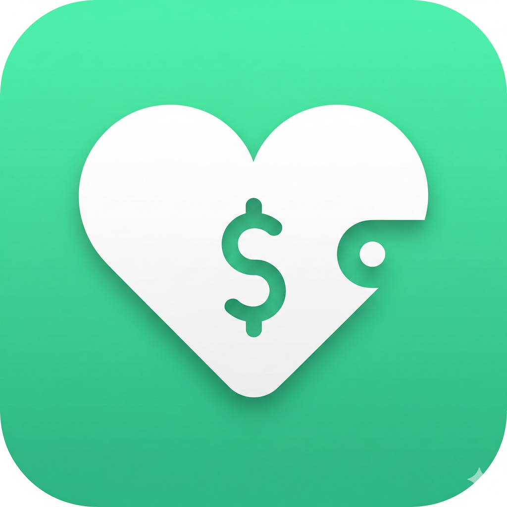

# DailySpend



**Private spending. Fair splitting.**

DailySpend is a native SwiftUI expense tracker and bill-splitting app for iPhone and iPad. Track purchases, follow budgets, calculate each person's share, and export a clear receipt. It calculates amounts owed; it does not transfer money or connect to bank accounts.

## Current status

**Version 2.0 (15) — in development.** Version 2.0 adds on-device Apple Intelligence receipt reading. It has not been through the release quality and data-safety reviews yet, and this is not an announcement of App Store availability. Confirm actual uploaded builds in App Store Connect.

Version 2.0 adds:

- **Smart receipt scanning:** scan with the camera or pick a photo. On devices with Apple Intelligence, Apple's on-device model reads the store, date, items, tax, tip, and total; DailySpend checks the arithmetic itself and fills a New Expense form to review. A scan button on Home goes straight from receipt to review. Other devices still read the total, as before.
- **Scan into a split:** Quick Split takes the bill total and any charged tip. By Item takes every line, tax, and tip; "2 × Dumplings" becomes two lines so different people can take each.
- **Simpler By Item:** one item list instead of separate personal and shared sections. Tap names on an item to choose who shares it; one name makes it personal. People added later join items shared by everyone.
- **Polish:** a "None" tip option and a combined Custom tip (% or fixed), the currency symbol beside the amount when adding an expense, a reset icon instead of a red trash can for starting a new split, the Monthly Change comparison window shown on the card, a trend line that no longer overshoots between days, currency symbols on budget settings, and Chinese text for strings that were English-only.
- **Smarter reading details:** tilted photos are straightened so prices stay with their items; Chinese receipts are read with automatic language detection (1.0 read them as garbled Latin text when English came first); all-capital names are shown in title case; store and pharmacy receipts get no default restaurant tip, so the split matches what was paid.
- **Fixes:** opening Category Limits no longer rounds a saved limit with cents (for example $180.50) to a whole number, and the "Add your first expense" button shows its plus icon again.

No stored data format changed: expenses, budgets, backups, and iCloud records use the same fields as 1.0. Receipt images and text are never stored or sent anywhere.

The September 2026 (1.0) update included:

- **New wallet branding:** a mint/teal wallet icon replaces the old heart branding, with matching artwork in Settings and the refreshed About page.
- **More dependable editing:** full-card transaction tap targets and coordinated Add/Edit presentation. Widget Quick Add waits for an existing edit to finish.
- **Clearer transaction rows:** red destructive swipe actions, multiline notes, and natural recurring labels instead of appended “(Auto)” text.
- **Better split receipts:** shared subtotals expand into individual items with each person's allocated amount and actual participant names. Long names wrap; a bitmap export path avoids blank tall receipts.
- **Polished amount entry:** the currency symbol sits beside the bill amount, numeric keyboards have a dismiss action, and decimal-comma input retains cents.
- **Widget and privacy refinements:** exact-cent snapshots, explicit empty/stale states, improved navigation, and hidden balances when App Lock is enabled and the widget refreshes.
- **Safer data handling:** validated backup imports, replacement-restore safeguards, CSV formula protection, and rollback of unsuccessful recurring-entry saves.

## Features

### Track spending

Add, edit, and categorize expenses with dates and notes. Set daily, weekly, monthly, or yearly recurring entries. Review monthly spending, category breakdowns, charts, and activity history. Set overall and category budgets, with optional local reminders.

Receipt scanning reads a camera capture or a photo on the device. With Apple Intelligence (iOS 26 or later on a supported device), the on-device model fills the store, date, items, tax, tip, and category; without it, DailySpend suggests the total. Every scan fills a form for you to **review** before anything is saved; reading is not guaranteed to be correct, and DailySpend flags totals that don't add up.

### Split fairly

- Divide a total evenly or list items and tap who shared each one.
- Scan a receipt to fill the total (Quick Split) or every item, tax, and tip (By Item).
- Include tax and percentage or fixed tips.
- Allocate rounding differences in cents so final shares reconcile with the bill.
- Export a per-person receipt and optionally record your own share as an expense.

A person's shared-item prices are **their allocated shares**, not full item prices. For example, $3 + $4 gives that person's $7 shared subtotal. Participant names identify who shared each item.

Unrecorded split calculations are temporary, not a persistent group-debt ledger.

### Widgets

Quick Add opens a new expense. Small and medium dashboard widgets show spending and budget information. iOS controls refresh timing, so saved changes may not appear immediately. Old snapshots can prompt you to open the app for a refresh.

### Privacy and portability

- No app-account registration, ads, subscriptions, in-app purchases, third-party analytics, or tracking.
- On-device expense storage, with private CloudKit sync when iCloud is available and enabled.
- Optional App Lock using device authentication and hidden financial content in the app switcher.
- Passphrase-encrypted JSON backups using Apple's CryptoKit and CommonCrypto. The passphrase is not stored or recoverable.
- Validated restore, merge, and replacement with a required safety backup before replacement.
- CSV exports are readable, **unencrypted**, and are not full backups. Earlier JSON backups may also be unencrypted.

iCloud sync is not an independent backup history: deletions can sync too. After enabling App Lock, iOS may temporarily retain an old rendered widget; remove it if its contents must be hidden immediately.

See the [privacy policy](docs/privacy/index.html) and [support page](docs/support/index.html).

## Build and run

- Deployment target: **iOS/iPadOS 17.0 or later**.
- Validation toolchain: **Xcode 26.6** on macOS. Use a recent Xcode that supports the project's synchronized folders and Swift settings; the old Xcode 15 instructions no longer apply.
- Frameworks: SwiftUI, SwiftData, CloudKit, Swift Charts, Vision/VisionKit, Foundation Models (iOS 26+, on-device only), PhotosUI, WidgetKit, UserNotifications, LocalAuthentication, CryptoKit, and CommonCrypto.
- Build with the iOS 26 SDK or later (Xcode 26+); the deployment target stays iOS 17, and Apple Intelligence features turn on only where available.

```bash
git clone https://github.com/ShadowSkeleton/DailySpend.git
cd DailySpend
open DailySpend.xcodeproj
```

Select the shared **DailySpend** scheme and an installed iPhone/iPad simulator, then run. For signed device builds, configure the appropriate development team and provisioning capabilities.

### Existing app identity

The public brand is DailySpend. These legacy identifiers deliberately remain unchanged for the existing distributed app:

| Purpose | Identifier |
|---|---|
| App bundle | `com.jackson.LoveLedger` |
| Private iCloud container | `iCloud.com.jackson.LoveLedger` |
| App Group | `group.com.jackson.LoveLedger` |
| Widget extension | `com.jackson.LoveLedger.LoveLedgerWidget` |

Do not rename them as a branding cleanup. They identify the existing app, storage, and shared widget data. A separate developer's fork needs its own registered identifiers and signing configuration; it cannot use the original developer's private CloudKit container.

For production-backed TestFlight testing, deploy the tested CloudKit schema to Production and verify sync on signed physical devices. Simulator tests do not prove production CloudKit access.

## Tests and release checks

Latest development verification, **October 25, 2026** (2.0 work in progress, Xcode 27.1 on macOS 27.0.1, iPhone 17 simulators):

| Runtime | Configuration | Result |
|---|---|---|
| iOS 27.0 | Debug | **81 passed** (66 unit/data, 15 UI), including the on-device Apple Intelligence receipt tests |
| iOS 27.0 | Release | **78 passed**; the three Debug-only UI tests excluded |
| iOS 26.5 | Debug | **80 passed, 1 skipped**: that simulator reports the model available but its safety model fails to load, so the model test skips and receipts fall back to reading the total |

On the iOS 27.0 simulator, fictional receipt photos chosen from Photos were read end to end in the app (restaurant, grocery with coupon, pharmacy with unit prices, Chinese hotpot with service charge). Signed physical-device results on iOS 26 and 27, the camera path, and the iOS 17–25 fallback on a real older runtime are still needed before release.

Earlier verification, September 10, 2026 (1.0 build 14): Release simulator build and 50 tests passed on iPhone 17e / iOS 26.5 with Xcode 26.6.

The shared scheme includes `DailySpendTests` and `DailySpendUITests`. Choose a simulator and press **Command-U** in Xcode to run the default Debug suite.

For Release testing, substitute an available simulator name:

```bash
xcodebuild test \
  -project DailySpend.xcodeproj \
  -scheme DailySpend \
  -configuration Release \
  ENABLE_TESTABILITY=YES \
  -destination 'platform=iOS Simulator,name=iPhone 17e' \
  -parallel-testing-enabled NO \
  -skip-testing:DailySpendUITests/DailySpendUITests/testDebugDemoDataMakesDashboardAndInsightsTestable \
  -skip-testing:DailySpendUITests/DailySpendUITests/testHomeScanFillsANewExpenseForReview \
  -skip-testing:DailySpendUITests/DailySpendUITests/testScannedReceiptFillsBothSplitModes
```

`ENABLE_TESTABILITY=YES` is a test-command override for unit tests' `@testable` import, not a shipping-build requirement. The skipped tests use Debug-only launch arguments: demo data, and a synthetic receipt in place of the camera.

Automated checks cover exact-cent allocations, receipt export, backup validation/encryption, recurrence/data migration, widget snapshots/privacy, keyboard dismissal, navigation, and transaction-sheet presentation. They do not replace physical-device checks for camera permissions, authentication, notifications, signed iCloud sync, installed-widget appearances, or upgrading an existing TestFlight installation.

- [Owner test plan, edge cases, and expected results](docs/PRE_UPLOAD_TEST_PLAN.md)
- [App Store release checklist](docs/APP_STORE_RELEASE_CHECKLIST.md)
- [Current TestFlight tester notes](docs/TESTFLIGHT_NOTES.md)
- [Tester data and App Store rollout workflow](docs/TESTER_DATA_WORKFLOW.md)

## Project guide

For everyday development, follow the [development workflow](docs/DEVELOPMENT_WORKFLOW.md) and [definition of done](docs/DEFINITION_OF_DONE.md). Pull requests use structured review templates and Debug/Release simulator CI with synthetic data, disabled signing, and no custom secrets. Hosted CI is limited to public repositories using standard free runners; release and migration safety checks remain separate.

| Path | Purpose |
|---|---|
| `DailySpend/Expense.swift`, `Money.swift`, `MoneyStoreMigration.swift` | Expense model, exact-cent arithmetic, migration |
| `DailySpend/HomeViews.swift`, `TransactionViews.swift` | Dashboard and entry/edit flows |
| `DailySpend/ReceiptDraft.swift` | Receipt values, exact-cent parsing, and the checks applied to model output |
| `DailySpend/ReceiptIntelligence.swift`, `ReceiptScanFlow.swift` | Vision text recognition, the on-device model, and the shared scan UI |
| `DailySpend/SplitBillLogic.swift`, `SplitBillView.swift`, `SplitBillComponents.swift` | Split calculations, receipt export, and shared split controls |
| `DailySpend/SettingsView.swift`, `SecureBackupCodec.swift` | Settings, About, backup and restore |
| `DailySpend/SceneProtectionWindow.swift` | Scene-level privacy protection |
| `DailySpend/WidgetSnapshot.swift`, `DailySpendWidget/` | Shared widget data and UI |
| `DailySpendTests/`, `DailySpendUITests/` | Automated regression checks |
| `docs/` | Public support/privacy pages and release documentation |

Local QA captures, personal Xcode settings, build products, and the separate App Store marketing kit are not included in this repository.

Created by **Jackson Feng**. Support: **jacksonfeng0130@yahoo.com**.
