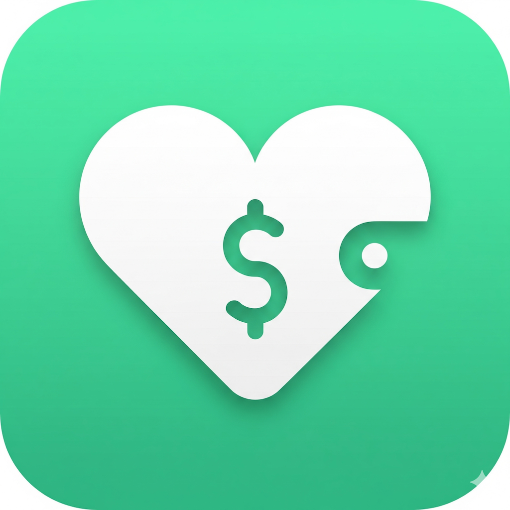
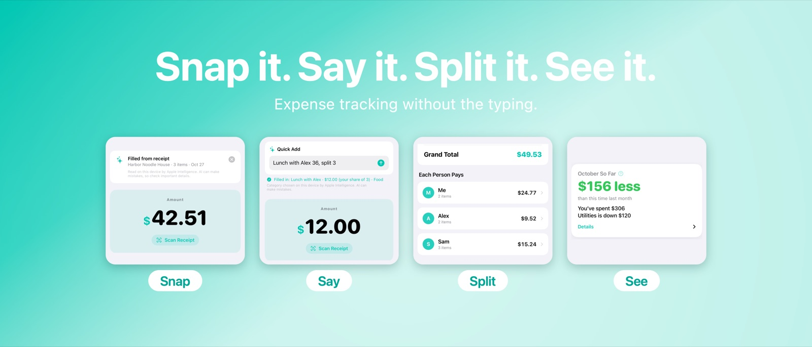
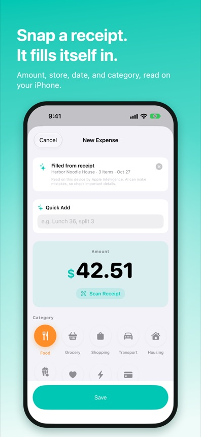
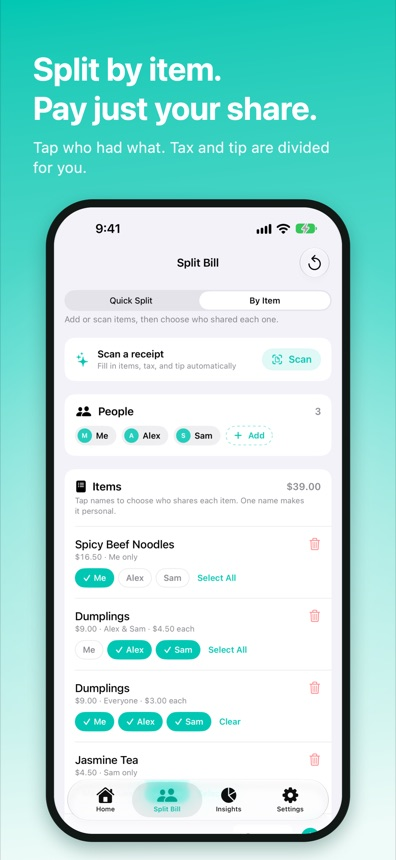
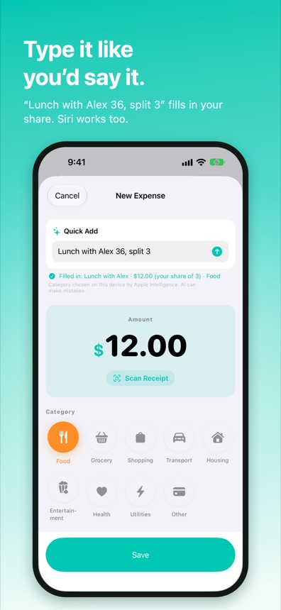
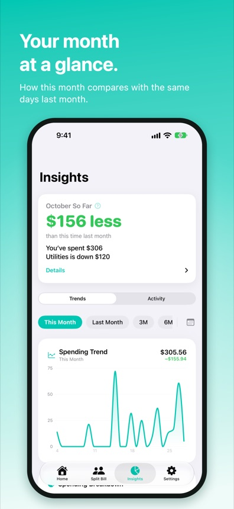
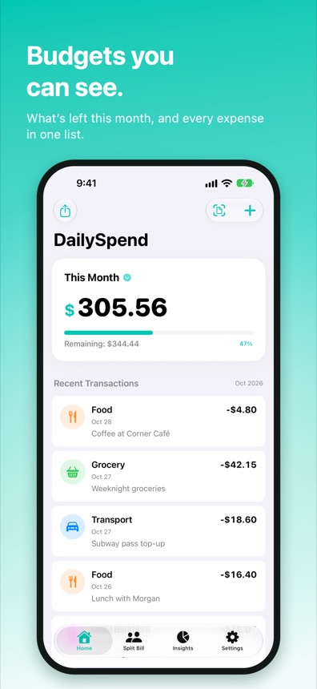
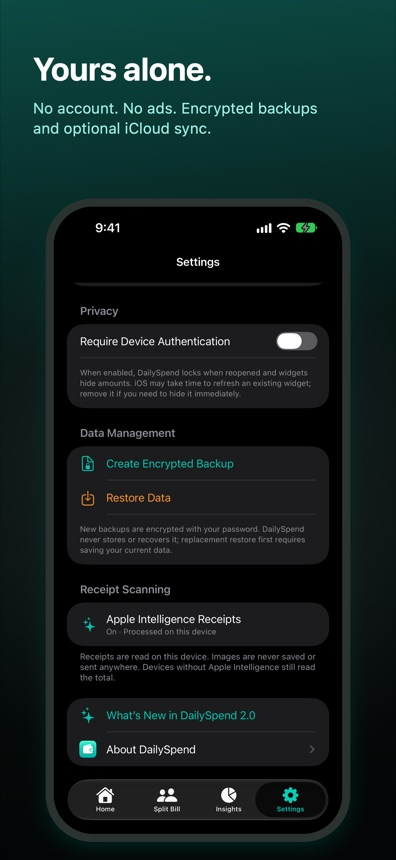

<div align="center">



# DailySpend

**Snap it. Say it. Split it. See it.**

An expense tracker and bill splitter for iPhone and iPad that does the typing for you, entirely on your device.

[](https://apps.apple.com/us/app/dailyspend-spend-split/id6756170183)
&nbsp;
[](https://github.com/ShadowSkeleton/DailySpend/actions/workflows/ci.yml)




</div>

## What's new in 2.0

<table>
  <tr>
    <td align="center" width="33%"><br><b>Snap a receipt</b><br><sub>Store, date, items, tax, tip, and total, read on the device. You check, then save.</sub></td>
    <td align="center" width="33%"><br><b>Split by item</b><br><sub>Tap who shared each dish. Tax and tip are divided to the cent.</sub></td>
    <td align="center" width="33%"><br><b>Say it in plain words</b><br><sub>"Lunch with Alex 25" or "昨天打车 23 块" becomes a ready-to-save expense.</sub></td>
  </tr>
  <tr>
    <td align="center"><br><b>See your month</b><br><sub>This month against the same days last month, in one sentence.</sub></td>
    <td align="center"><br><b>Budgets you can see</b><br><sub>Monthly and category limits with gentle reminders.</sub></td>
    <td align="center"><br><b>Yours alone</b><br><sub>No account, no ads. Optional iCloud sync and encrypted backups.</sub></td>
  </tr>
</table>

Also new: **Siri, Shortcuts, and Controls** (log an expense, scan a receipt, or ask what you've spent; Control Center, Lock Screen, and Action button), and a one-time tour of the new features. Full notes are in the [changelog](CHANGELOG.md).

## Features

**Track spending.** Add, edit, and categorize expenses with dates, notes, and daily, weekly, monthly, or yearly repeats. Charts, category breakdowns, and activity history. Overall and per-category budgets with optional reminders.

**Scan receipts.** Use the camera or a photo. With Apple Intelligence (iOS 26 or later on a supported device), Apple's on-device model organizes the receipt and DailySpend checks every amount against the printed text and totals. Without it, DailySpend reads the total. Every scan fills a form to **review**; nothing is saved until you do. If something looks off, scanning the whole receipt again usually fixes it.

**Split fairly.** Divide a total evenly, or list items and tap who shared each one. Tax and percentage or fixed tips are included, and rounding cents are allocated so every share adds up to the bill. Export a per-person receipt and record your own share as an expense. DailySpend calculates who owes what; it never moves money or connects to a bank.

**Widgets.** Quick Add opens a new expense. Small and medium dashboard widgets show spending and budget status.

**Privacy.** No sign-up, ads, subscriptions, in-app purchases, analytics, or tracking. Expenses stay on the device, with private iCloud sync if you turn it on. Optional App Lock with Face ID or passcode. Passphrase-encrypted backups (CryptoKit); the passphrase is never stored. Receipt images and text are never kept or sent anywhere.

Read the [privacy policy](docs/privacy/index.html) and [support page](docs/support/index.html).

> **Good to know:** iCloud sync isn't a backup history, because deletions sync too. CSV exports are readable spreadsheets, not encrypted backups.

## Build and run

| | |
|---|---|
| Deployment target | iOS / iPadOS 17.0 |
| Toolchain | Xcode 27.1 (CI also builds with Xcode 26.6) |
| Frameworks | SwiftUI, SwiftData, CloudKit, Swift Charts, Vision, VisionKit, Foundation Models (on-device, iOS 26+), App Intents, WidgetKit, LocalAuthentication, CryptoKit |

```bash
git clone https://github.com/ShadowSkeleton/DailySpend.git
cd DailySpend
open DailySpend.xcodeproj
```

Select the shared **DailySpend** scheme and a simulator, then run. Apple Intelligence features turn on only where the device supports them; everything else works back to iOS 17. For a signed device build, set your own development team.

<details>
<summary><b>App identity (don't rename)</b></summary>

The public name is DailySpend, but these identifiers stay as they are because they identify the shipped app, its storage, and its shared widget data:

| Purpose | Identifier |
|---|---|
| App bundle | `com.jackson.LoveLedger` |
| Private iCloud container | `iCloud.com.jackson.LoveLedger` |
| App Group | `group.com.jackson.LoveLedger` |
| Widget extension | `com.jackson.LoveLedger.LoveLedgerWidget` |

A fork needs its own registered identifiers and signing; it can't use this app's private CloudKit container. For TestFlight builds against production iCloud, deploy the tested CloudKit schema to Production and verify sync on signed devices.

</details>

## Tests

Every pull request runs the full **Debug** and **Release** suites on GitHub's iPhone 17e simulator, with synthetic data, signing disabled, and no secrets. In Xcode, press **Command-U** for the Debug suite.

<details>
<summary><b>Release test command</b></summary>

```bash
xcodebuild test \
  -project DailySpend.xcodeproj \
  -scheme DailySpend \
  -configuration Release \
  ENABLE_TESTABILITY=YES \
  -destination 'platform=iOS Simulator,name=iPhone 17e' \
  -parallel-testing-enabled NO \
  -skip-testing:DailySpendUITests/DailySpendUITests/testDebugDemoDataMakesDashboardAndInsightsTestable \
  -skip-testing:DailySpendUITests/DailySpendUITests/testHomeScanFillsANewExpenseForReview \
  -skip-testing:DailySpendUITests/DailySpendUITests/testScannedReceiptFillsBothSplitModes \
  -skip-testing:DailySpendUITests/DailySpendUITests/testScanLinkOpensTheScannerForReview \
  -skip-testing:DailySpendUITests/DailySpendUITests/testQuickSplitScansRealReceipts \
  -skip-testing:DailySpendUITests/DailySpendUITests/testWhatsNewOffersABackupAfterAnUpdate \
  -skip-testing:DailySpendUITests/DailySpendUITests/testWhatsNewInChinese
```

`ENABLE_TESTABILITY=YES` lets unit tests use `@testable import`; it isn't needed for shipping builds. The skipped tests rely on Debug-only launch arguments (demo data and a synthetic receipt in place of the camera).

</details>

Automated checks cover exact-cent splits, receipt reading and its checks, backup encryption and validation, data migration, widget snapshots, and the main screens. Camera, Face ID, notifications, signed iCloud sync, and upgrading a real installation are checked on devices before each release; see [`docs/releases/`](docs/releases/).

## Project guide

| Path | Purpose |
|---|---|
| `DailySpend/Expense.swift`, `Money.swift`, `MoneyStoreMigration.swift` | Expense model, exact-cent arithmetic, migration |
| `DailySpend/HomeViews.swift`, `TransactionViews.swift` | Dashboard and entry/edit flows |
| `DailySpend/ReceiptDraft.swift` | Receipt values and the checks applied to model output |
| `DailySpend/ReceiptIntelligence.swift`, `ReceiptScanFlow.swift` | Text recognition, the on-device model, and the scan UI |
| `DailySpend/SplitBillLogic.swift`, `SplitBillView.swift`, `SplitBillComponents.swift` | Split calculations, receipt export, split controls |
| `DailySpend/SettingsView.swift`, `SecureBackupCodec.swift` | Settings, About, backup and restore |
| `DailySpend/WidgetSnapshot.swift`, `DailySpendWidget/` | Shared widget data and UI |
| `DailySpendTests/`, `DailySpendUITests/` | Automated tests |
| `docs/` | Support and privacy pages, release reports, and guides |

Contributing: follow the [development workflow](docs/DEVELOPMENT_WORKFLOW.md) and [definition of done](docs/DEFINITION_OF_DONE.md).

<details>
<summary><b>Release and testing docs</b></summary>

- [2.0 build, TestFlight, and App Store guide](docs/RELEASE_GUIDE_2.0.md)
- [Release reports](docs/releases/) (quality and data safety, per build)
- [TestFlight notes](docs/TESTFLIGHT_NOTES.md) and [tester data workflow](docs/TESTER_DATA_WORKFLOW.md)
- [2.0 manual test plan](docs/V2_MANUAL_TEST_PLAN.md) and [fictional test receipts](docs/test-receipts/README.md)
- [Owner test plan](docs/PRE_UPLOAD_TEST_PLAN.md) and [App Store release checklist](docs/APP_STORE_RELEASE_CHECKLIST.md)
- [2.0 marketing kit](docs/marketing/V2_MARKETING.md) and [storefront kit](docs/marketing/V2_STOREFRONT.md)
- Try a development build beside the App Store app: `scripts/device-test/install-on-device.sh <device-udid>` installs "DailySpend Test" with its own empty data and no iCloud.

</details>

---

<div align="center">
<sub>Made by <b>Jackson Feng</b> · Support: jacksonfeng0130@yahoo.com</sub>
</div>
